# Relay

## Team

- Dallas Lendaris (GitHub: @DallasLendaris)
- Steven Tinoco (GitHub: @TODO-steven)
- Roman Lozano (GitHub: @TODO-roman)

SJSU Software Engineering senior capstone (CMPE 195A/B), 2026–2027. Clients: Eric Lopez and Joel Chacon, California State Capitol staff.

## Project Description

Official emergency alerts reach people as dense text, often in one language, and nobody learns whether they were received. Relay relays official alerts (National Weather Service first; USGS and FEMA IPAWS later) to the places people save, in plain language and their own language, and lets them answer "I'm okay" with one tap. Agencies that adopt Relay see anonymous per-area response counts, so they can find neighborhoods that are not answering.

## Proof of Concept Scope

**Claim:** a real NWS alert covering a saved place reaches a phone as a push notification within 60 seconds, and the phone's "I'm okay" is counted once in that place's H3 cell.

**The technical risk this addresses.** The hardest part of Relay is the alert engine: taking a messy, changing government feed, deciding exactly which phones an alert covers, never pushing the same alert twice, never pushing anything that is not a real (`Actual`) and Relay-signed alert, and turning taps into trustworthy per-area counts. The PoC runs that engine end to end:

1. **Ingest:** poll the NWS active-alerts feed for California, archive the raw response, validate each alert, keep only `Actual`, handle updates and cancels.
2. **Locate:** turn the alert's polygon, or its forecast zones, into H3 cells (resolution 7).
3. **Sign and store:** add English and Spanish plain-language summaries, sign the alert (ECDSA P-256), store it.
4. **Match and deliver:** match the cells to saved places, queue one job per device, and have the delivery worker re-verify the signature, claim `alert:severity:device` so nothing is sent twice, and push through Expo.
5. **Check in:** the push carries a signed, expiring check-in token bound to the device, alert and cell. The phone sends it back; the server verifies it and counts the device once per alert.

**How it runs.** Relay is designed for AWS (Lambda, SQS, Aurora, DynamoDB, KMS) and the CDK code for that is in `infra/`. The team has no hosting funding yet (the funding pitch to the State of California is in December), so nothing is deployed. The PoC instead runs the **same engine and API code** in **local mode** on one machine: in-memory adapters stand in for Aurora, DynamoDB and SQS, and an in-memory key stands in for KMS. The NWS feed and Expo push are real when the machine has internet (`RELAY_FEED=live`, `RELAY_PUSH=expo`); offline, a saved NWS response is replayed and pushes are logged (the defaults, used by the grader).

**Intentionally not included yet:** AWS deployment, the designed app UI (it exists in Figma), the agency map and dashboard, USGS and IPAWS feeds, languages beyond English and Spanish, family circles, "I need help", and the statewide fan-out path (designed and load-tested locally, in `backend/src/scale/` and `loadtest/`, but not part of this claim).

## System Architecture

```mermaid
flowchart LR
  NWS["NWS active-alerts API<br/>(or saved response in replay)"] -->|poll every 30 s| ING
  subgraph Engine["Relay engine (backend/src)"]
    ING["ingest/<br/>poll, archive, normalize,<br/>lifecycle"] --> GEO["geo/<br/>polygon or zones to H3 cells"]
    GEO --> SIGN["summaries/ + signing/<br/>EN/ES text, ECDSA signature"]
    SIGN --> STORE[("Alert store")]
    STORE --> PLAN["delivery/plan-delivery<br/>match cells to saved places"]
    PLAN --> Q[["Delivery queue"]]
    Q --> WORK["delivery/worker<br/>re-verify, claim, send"]
  end
  WORK -->|Expo push| PHONE["Phone app (app/)"]
  PHONE -->|"POST /devices, /places"| API["api/<br/>REST API (OpenAPI in packages/shared)"]
  PHONE -->|"POST /alerts/{id}/checkins<br/>with signed token"| API
  API --> PLACES[("Devices and places")]
  API --> CHK[("Check-ins, totals per H3 cell")]
  PLAN --- PLACES
  CHK --> AG["Agency view<br/>(status page in the PoC)"]
```



| Component                  | Local mode (this PoC)                                 | AWS design (`infra/`)                                    |
| -------------------------- | ----------------------------------------------------- | -------------------------------------------------------- |
| Poll scheduler             | `setInterval` in `backend/scripts/local-server.ts`    | EventBridge rule, ingest Lambda                          |
| Alert, place, device store | In-memory adapters (`backend/src/adapters/memory/`)   | Aurora Serverless v2 PostgreSQL + PostGIS                |
| Delivery queue             | In-memory queue drained by the real `deliveryWorker`  | SQS + delivery Lambda                                    |
| Send dedupe                | In-memory idempotency store                           | DynamoDB conditional writes                              |
| Alert signing              | In-memory ECDSA P-256 key, new each start             | KMS asymmetric key (only the public key on verifiers)    |
| Check-ins                  | In-memory store with per-cell totals                  | DynamoDB + Streams aggregator                            |
| API                        | Node `http` server around the same `createApi` router | API Gateway HTTP API + Lambda, behind CloudFront and WAF |
| Push                       | Expo push service, or a log                           | Expo for the pilot; direct APNs/FCM senders at scale     |

Where the PoC code lives: `backend/src/local/` (local mode wiring, scenario, HTTP server), `backend/scripts/` (`local-server.ts`, `simulate.ts`, `capture-nws.ts`), `app/` (phone client). Everything the local mode calls into (`ingest/`, `geo/`, `delivery/`, `signing/`, `tokens/`, `api/`) is the production engine.

## Prerequisites

- Ubuntu, macOS or Windows (WSL) with **Node.js 22** (`node -v` ≥ 22) and **npm 10**
- **git**
- No AWS account and no credentials of any kind for the build, tests and simulation
- For the phone demo only: a real phone on the same Wi-Fi as the computer, the **Expo Go** app (iPhone), or an Android development build, and a free **Expo account** (to create the project id push tokens need). See `app/README.md`.

## Installation

```
git clone https://github.com/DallasLendaris/relay.git
cd relay
git checkout poc-v1
npm ci
```

`npm ci` installs every workspace (`packages/shared`, `backend`, `infra`, `loadtest`). It is the only step that needs internet. The phone app has its own install (`cd app && npm ci`), only needed for the phone demo.

Configuration is optional. Every variable is listed with its default in `.env.example`; export the ones you want in your shell. No variable holds a secret the grader needs.

## Running the PoC

**1. One scripted run (offline, exits by itself):**

```
npm run simulate
```

It replays a real NWS California feed recorded on Nov 13, 2026 (42 alerts, in `backend/dev-data/replay/`) through the engine and API. It places one phone inside a pushable alert from that recording (a Winter Storm Warning in the Eastern Sierra) and a control phone outside every alert. Then it polls the feed, stores and signs the alerts, pushes to the first phone only, taps "I'm okay" twice, and checks that the cell total is 1. It prints each step and `PASS`, and exits non-zero if any step fails. If a recording holds no alert that would be pushed, it says so and uses the constructed sample in the same folder.

**2. The server (keeps running):**

```
npm run local
```

Then, in another terminal:

```
curl -fsS http://localhost:8787/health
curl -fsS http://localhost:8787/local/status
```

Open `http://localhost:8787/` for a status page that shows stored alerts, pushes sent and "I'm okay" totals per H3 cell, refreshing every 2 seconds. `POST /local/poll` polls immediately instead of waiting 30 seconds.

**3. Live, with a phone (needs internet):**

```
RELAY_FEED=live RELAY_PUSH=expo npm run local
```

Then follow `app/README.md` to run the app, connect it to `http://<this computer's LAN address>:8787`, and save a place. If no live California alert covers the place, keep `RELAY_FEED=replay` and save the app's demo point: the replayed alert still goes through Expo's real push service to the phone.

**Recording real NWS data:** `npm run capture-nws -w @relay/backend` saves the live feed and its zone shapes to `backend/dev-data/replay/recorded-<time>.json`. Or run the **Capture NWS feed** workflow from the GitHub Actions tab, which records on a GitHub runner and commits the files to the branch it runs on. Replay and `simulate` use the newest recording automatically, and a test checks that every recording ingests with no errors. Replay sets its clock to the newest alert's send time, so the recorded alerts are active.

## Testing

```
npm run poc:test
```

Runs the automated tests of `packages/shared`, `backend` and `loadtest` (about 1,735 tests). Highlights:

- `backend/test/local/local-mode.test.ts`: the PoC path through local mode and its HTTP server, including a phone that saves its place after the alert arrived.
- `backend/test/e2e/demo-path.test.ts`: the same path on the engine's adapters, plus failure cases (a fan-out that fails halfway, retried pushes, kill switch, updates and cancels).
- Safety tests: unsigned or tampered alerts are never sent, `Test`/`Exercise` alerts are rejected, a device is counted once per alert, tokens for another alert or device are refused.

```
npm run poc:build
```

Builds the shared package, type-checks every workspace, and synthesizes the AWS CDK app for the dev stage (`cdk synth`), which also runs the cdk-nag NIST 800-53 checks on every stack. The 464 infrastructure tests run with `npm test -w @relay/infra`. They are left out of `poc:test` because they take about 7 minutes on 2 CPUs.

`npm run lint` checks style across the repo; CI (`.github/workflows/ci.yml`) runs lint, type-check and all tests on every pull request.

**Verified by hand, not automatically:** that a push from Expo appears on a real phone and that the tap reaches the server. That is shown in the demo video.

## Demo

- **Video:** TODO, link added before submission (3–5 minutes, narrated: server log, phone push, "I'm okay", the cell count going up, then `npm run simulate` and the tests).
- **Simulation log:** [`docs/demo/simulate.log`](docs/demo/simulate.log)
- **Status page after the scripted run:** [`docs/demo/status-page.png`](docs/demo/status-page.png)
- **Test run:** [`docs/demo/test-summary.log`](docs/demo/test-summary.log)
- **Scale evidence (not part of the claim):** [`loadtest/results/fanout-1m-local-v2.md`](loadtest/results/fanout-1m-local-v2.md), one alert fanned out to 1,000,000 simulated devices against mock APNs and FCM on one machine.

## Technical Stack

- **Language:** TypeScript 5 on Node.js 22 (ES modules)
- **Engine and API:** plain Node, no web framework; `zod` 4 for validation, `h3-js` 4 for H3 cells, `@turf/boolean-point-in-polygon` for geometry, Node `crypto` for ECDSA P-256 alert signatures and HMAC check-in tokens
- **Contract:** OpenAPI 3 (`packages/shared/openapi/relay.yaml`) with generated types
- **Phone app:** Expo SDK 58, React Native 0.88, React 19, `expo-notifications`, `expo-location`
- **Push:** Expo push service
- **Cloud design (not deployed):** AWS CDK 2 (TypeScript), Lambda, SQS, EventBridge, Aurora Serverless v2 PostgreSQL + PostGIS, DynamoDB, KMS, S3, API Gateway, CloudFront, WAF, Cognito; `cdk-nag` NIST 800-53 Rev. 5 rules
- **Data source:** National Weather Service API (`api.weather.gov`)
- **Testing and tooling:** Vitest 3, PGlite (Postgres migrations in tests), ESLint 9, Prettier 3, GitHub Actions, gitleaks, CodeQL

## What's Next (195B)

- **Deploy to AWS:** create the dev and prod accounts and deploy through the existing GitHub Actions pipeline (`docs/runbooks/deploy.md`), then repeat this PoC on AWS.
- **The designed app:** build the Figma screens (alert detail, home, family circle, onboarding, saved places) in the Expo app, with accessibility and large text.
- **Agency side:** the response-cluster map and the agency sign-in (Cognito with TOTP; the read-only agency API is drafted).
- **Pilot readiness:** one county partner, the funding decision from the state, a native-speaker review of the Spanish text, and the remaining California languages (Tagalog, Chinese, Vietnamese, Korean).
- **More sources:** USGS ShakeAlert and FEMA IPAWS.
- **Features:** family circles, "I need help", evacuation routes.
- **Scale:** switch from Expo to the direct APNs/FCM senders and the sharded fan-out for statewide volume.

---

How we work: issues on the GitHub Projects board, branches named `<issue>-short-description`, one approval from outside the area per pull request, and never committing keys or `.env` files. Full team structure: "Relay Team Structure" in the team's Drive folder.
