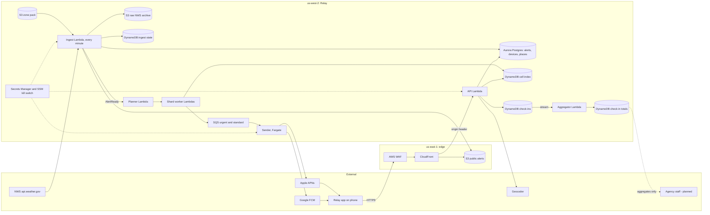

# Relay system security plan (outline)

> **Draft, pending review by SJSU counsel / the agency ISO.** This document describes Relay as built at commit `74acc5c` plus the fixes planned in the audit-fix round. It does not claim compliance with SAM 5300, SIMM 5315-B or any other standard. Where a control is missing it says so.

Prepared for the California Cloud Services Assessment (CCSA). The CCSA asks for a "Cloud System Security Plan (CSSP)" among its uploaded artifacts ([CDT CCSA page](https://cdt.ca.gov/services/ccsa), verified 2026-11-09). This outline is the starting point for that CSSP. The CCSA page lists SIMM 5315-B (Cloud Security Standard), SIMM 140 (Cloud Security Guide) and SAM 5305.7 (Security Risk Assessment) as the standards the assessment validates. Those documents were **not** retrieved for this draft, so the control families below follow common practice and still have to be mapped to the SIMM controls by the agency ISO.

Status words used throughout:

- **Built**: present in the code at the audited commit.
- **Fix planned**: a finding is open and a fix is assigned in the audit-fix round. It may not be merged yet. Re-check against `main` before relying on it.
- **Not built**: absent, with no fix scheduled yet.

Finding IDs (GOV-n, PRIV-n, SEC-A/B/C-n, OPS-n, REL-n, SAFE-n, RED-n) refer to the audit ledger kept by the capstone team. It is not committed to the repository.

## 1. System description and boundary

**Purpose.** Relay redistributes National Weather Service (NWS) alerts for California to people who saved places in the Relay phone app, and lets them tell family and agencies "I'm okay". Agencies see response totals per H3 cell, never individual check-ins. See [positioning](../positioning.md) for what Relay is and is not.

**Operator.** Undecided. Candidates are an SJSU or CSU entity, an auxiliary, a state agency, or a county. The choice decides whether the Information Practices Act or the CCPA/CPRA applies and who the ISO is (see the [open questions](./README.md#decisions-and-questions)).

**Hosting.** AWS, one primary region (`us-west-2`), plus `us-east-1` for CloudFront, WAF and the public alert bucket. Nothing is deployed yet: the AWS accounts (ticket S-06) do not exist. Everything described here is built and tested offline.

**Environments.** `dev` and `prod`, one CDK app (`infra/lib/relay-app.ts`). Stacks: config, data, delivery (legacy), fanout, api, ingest, sender, edge.

**Authorization boundary.** Inside: the AWS accounts, the Relay backend code, the mobile app, and Relay-held secrets. Outside, and treated as external services:

| External party                | What crosses the boundary                                                                                                  |
| ----------------------------- | -------------------------------------------------------------------------------------------------------------------------- |
| NWS (api.weather.gov)         | Inbound public alert data. No Relay data goes out except a User-Agent string.                                              |
| Apple APNs, Google FCM        | Outbound push: device push token, alert headline and summary, collapse key. Recipients are not identified to the provider. |
| Geocoder (address lookup)     | Outbound: the address a user types when adding a place. Provider and terms are to be confirmed.                            |
| Expo push (development only)  | Outbound push token and alert text. Not for production use.                                                                |
| Agencies (planned, not built) | Per-cell check-in totals through an authenticated agency API. See gap G-1 below.                                           |
| GitHub (CI)                   | Source code. No production credentials. A deploy pipeline and OIDC role do not exist yet (SEC-C-10).                       |

**Users.** Members of the public (anonymous app installs, no account) and, later, agency staff (not built).

## 2. Architecture and data flow

Flow summary (from `docs/STATUS.md` and `docs/scale-plan.md`):

1. EventBridge starts ingest every minute. It polls NWS, archives the raw response, validates and normalizes alerts (only `Actual` ones), turns the area into H3 resolution 7 cells, signs the alert (HMAC) and stores it in Aurora.
2. Ingest publishes `AlertReady`. The planner shards the area, shard workers read the DynamoDB cell index and enqueue send batches. Sender containers on Fargate send through APNs and FCM and honor the kill switch.
3. The phone shows the push. "I'm okay" sends a signed check-in token to the API, which writes one row per device per alert. A stream aggregator keeps per-cell totals.
4. Agencies (later) read totals only.

Trust boundaries to review:

- Internet to CloudFront/WAF.
- CloudFront to the API (origin-verify header, which the audit found can be bypassed through the default execute-api endpoint, SEC-C-2).
- Lambda to Aurora (Data API, one shared admin credential, PRIV-6).
- Fargate to APNs/FCM.

## 3. Data inventory

Derived from the audited code and migrations. Retention is "as built" with the planned fix alongside.

| Data element                                                                                  | Store                                         | Why                                       | Sensitivity                  | Retention as built                         | Planned                                         | Finding              |
| --------------------------------------------------------------------------------------------- | --------------------------------------------- | ----------------------------------------- | ---------------------------- | ------------------------------------------ | ----------------------------------------------- | -------------------- |
| Device id (random uuid) and credential hash                                                   | Aurora `devices`                              | Anonymous install identity                | Pseudonymous identifier      | Until manual deletion; no delete endpoint  | `DELETE /devices/me`, inactivity expiry         | GOV-3, PRIV-1, 11    |
| Language (en or es only)                                                                      | Aurora `devices`                              | Summary language                          | Low                          | As above                                   | BCP-47 list                                     | GOV-7                |
| Push token (APNs, FCM or Expo) and platform                                                   | Aurora `devices`; cell index; SQS messages    | Deliver push                              | Persistent device identifier | As above; SQS up to 14 days incl. DLQs     | Deleted with device                             | PRIV-7, PRIV-9       |
| Saved place label and short address                                                           | Aurora `places`                               | Show the place in the app                 | High: home or work address   | Until manual deletion; never used by match | Keep on device only                             | PRIV-5               |
| Exact latitude and longitude of each saved place                                              | Aurora `places`                               | Computing the H3 cell                     | High: precise home location  | Until manual deletion                      | Store cell only                                 | PRIV-5               |
| H3 res-7 cell per place (about 5 km2)                                                         | Aurora; DynamoDB cell index (with push token) | Match alerts to people                    | Moderate: neighborhood       | Until deletion; index has no TTL           | Deleted with device                             | PRIV-11              |
| Check-in: alertId, deviceId, H3 cell, time                                                    | DynamoDB `checkins`                           | One check-in per device per alert; counts | High: device in cell at time | No TTL; PITR on and table retained in prod | TTL 30 days after the alert, plus device delete | GOV-2, PRIV-2        |
| Check-in totals per alert and cell                                                            | DynamoDB totals                               | Agency view                               | Aggregate; small cells risky | TTL set by aggregator                      | Suppression and noise rules before agency use   | PRIV-3, PRIV-4       |
| Alerts, summaries, signatures                                                                 | Aurora; S3 public bucket                      | Public alert content                      | Public                       | Indefinite                                 | Counsel to set                                  | OPS-12               |
| Raw NWS responses                                                                             | S3 raw bucket                                 | Audit and replay                          | Public data                  | Infrequent-access after 30 days, no expiry | Counsel to set                                  | SEC-C-11             |
| Secrets: token, alert, device-credential keyrings; APNs and FCM keys; DB admin; origin secret | Secrets Manager                               | Signing and delivery                      | Critical                     | Until rotated; no rotation schedule        | Rotation runbook; KMS signing                   | SEC-C-5, 7, OPS-6, 8 |
| Application logs (no tokens, no coordinates by policy)                                        | CloudWatch Logs                               | Operations                                | Low, with leaks (PRIV-10)    | One month                                  | Longer audit retention                          | GOV-10, PRIV-10      |

Users enter no name, email or phone number. The API does not authenticate people, only installs.

## 4. Controls: in place and planned

Families follow the list requested for the CCSA package. IDs in the last column are audit findings.

### 4.1 Access control (AC)

| Control                                    | Status      | Notes                                                                             | Findings                     |
| ------------------------------------------ | ----------- | --------------------------------------------------------------------------------- | ---------------------------- |
| Public API limited to device-scoped access | Built       | Stateless HMAC device credential; check-in tokens bind alert, device and cell.    | SEC-A clean on token forging |
| Per-function least-privilege IAM           | Built       | Helper `grants.ts`; each stack scopes its roles. Exceptions below.                | -                            |
| Separate database roles per function       | Fix planned | Every compute role uses the `relay_admin` secret today.                           | PRIV-6, SEC-C-6              |
| API Lambda cannot enqueue arbitrary sends  | Fix planned | API holds SQS send and token keys.                                                | SEC-C-1, RED-1               |
| Agency authentication and authorization    | Not built   | No Cognito or equivalent. Agency route (AG-04) not built. Hard gate for agencies. | GOV-6, SEC-A-4               |
| Device-minting abuse limits                | Fix planned | One phone can mint many device identities and forge check-ins at scale.           | SEC-A-1, SEC-B-1             |
| Admin human access (console, break glass)  | Not built   | No account structure, SSO or break-glass procedure yet; accounts do not exist.    | -                            |

### 4.2 Audit and accountability (AU)

| Control                                         | Status    | Notes                                                                                        | Findings        |
| ----------------------------------------------- | --------- | -------------------------------------------------------------------------------------------- | --------------- |
| Structured JSON application logs, no tokens     | Built     | Leaks found: a deviceId in one log line, raw error strings, token redaction misses APNs/FCM. | PRIV-10         |
| CloudTrail, GuardDuty, Config, Security Hub     | Not built | No audit trail of who flipped the kill switch or changed a secret.                           | GOV-10, SEC-C-4 |
| CloudFront, WAF, API and S3 access logs         | Not built |                                                                                              | SEC-C-4         |
| Log retention                                   | Partial   | One month on all log groups. A state audit window is likely longer; agency ISO to set.       | GOV-10          |
| Alert-send audit record (who sent what to whom) | Partial   | Dedupe and sent markers exist per batch; no operator-action log.                             | OPS-3           |

### 4.3 Configuration management (CM)

| Control                                  | Status      | Notes                                                                        | Findings        |
| ---------------------------------------- | ----------- | ---------------------------------------------------------------------------- | --------------- |
| Infrastructure as code (CDK, TypeScript) | Built       | Synth is tested for dev and prod. Tags `project` and `stage`.                | -               |
| CI: lint, typecheck, tests               | Built       | GitHub Actions, no `permissions` block, actions tag-pinned not SHA-pinned.   | DEP-4, SEC-C-10 |
| Deploy pipeline with approvals           | Not built   | Deploys are manual. OIDC deploy role is ticket S-06.                         | SEC-C-10        |
| Safe prod defaults                       | Fix planned | A prod deploy without `-c senderEnabled=true` sets the sender fleet to zero. | OPS-4, RED-8    |
| Database migrations                      | Partial     | Plain SQL files; autocommit per statement, no lock, half-apply possible.     | OPS-9           |
| Image pinning, `.dockerignore`           | Not built   | `node:22-slim` not digest pinned; source maps shipped.                       | DEP-2, 3, 7     |

### 4.4 Contingency planning (CP)

See the [business impact analysis and contingency plan](./business-impact-and-contingency.md). Summary: single region, no failover, no DR test. Aurora backup retention is one day at the audited commit (fix planned to 14 days); DynamoDB PITR is on in prod.

| Control                        | Status      | Findings              |
| ------------------------------ | ----------- | --------------------- |
| Database backups               | Partial     | SEC-C-8, OPS-5        |
| Cross-region replication       | Not built   | OPS-13                |
| Key material recoverable       | Not built   | OPS-6                 |
| Restore runbook, DR test       | Not built   | OPS-5, OPS-11         |
| Alarm actions and on-call      | Fix planned | OPS-1, SEC-C-3, OPS-2 |
| Technology Recovery Plan (TRP) | Not built   | See note below        |

The CCSA page says the Technology Recovery Plan is validated during the assessment, though it is not one of the listed uploads.

### 4.5 Identification and authentication (IA)

| Control                                                         | Status            | Findings                                                                                    |
| --------------------------------------------------------------- | ----------------- | ------------------------------------------------------------------------------------------- |
| Device credential: random, HMAC-derived, stateless, hash stored | Built             | PRIV-9 (cannot be revoked)                                                                  |
| Check-in token: HMAC, binds alert, device, cell, expiry         | Built             | REL-6 (expiry fixed at fan-out end)                                                         |
| Constant-time compare, strict token formats                     | Partial           | SEC-A-9 (lenient base64url), SEC-A-10 (all-zero key accepted)                               |
| Origin verification header between CloudFront and API           | Built, bypassable | SEC-C-2, SEC-A-7                                                                            |
| Attestation (App Attest, Play Integrity)                        | Not built         | SEC-A-1                                                                                     |
| Agency identity (SSO, MFA)                                      | Not built         | GOV-6                                                                                       |
| Alert signing key: symmetric, held by five identities           | Built, weak       | SEC-C-7, RED-2 (fix idea: KMS asymmetric signing)                                           |
| Key rotation tooling                                            | Partial           | `seed-keys --rotate` can overwrite a live key (SEC-C-5); no APNs/FCM rotation steps (OPS-8) |

### 4.6 Incident response (IR)

See [incident response](./incident-response.md). Detection is the weakest part: there are 12 CloudWatch alarms at the audited commit, none with an action, so nothing pages anyone (OPS-1, SEC-C-3). The README text that says alarms "page" is wrong. Missing alarms are listed under OPS-2.

### 4.7 Media protection (MP)

| Control                              | Status    | Notes                                                                                                                                  | Findings |
| ------------------------------------ | --------- | -------------------------------------------------------------------------------------------------------------------------------------- | -------- |
| Encryption at rest                   | Built     | Aurora storage encrypted; S3-managed keys; SQS-managed keys; DynamoDB default AWS-owned key. Customer-managed KMS keys are not used.   | PRIV-6   |
| Encryption in transit                | Built     | S3 `enforceSSL`; HTTPS to CloudFront; Data API over HTTPS. CloudFront default certificate allows TLS 1.0 and sets no security headers. | SEC-C-9  |
| Bucket public access blocked         | Built     | The public bucket is served through CloudFront.                                                                                        | -        |
| Bucket versioning                    | Not built | Zone pack and public alerts are unsigned and unversioned.                                                                              | SEC-C-11 |
| Removable media, device sanitization | N/A       | Managed AWS services. Backup purge after a delete request is undefined.                                                                | PRIV-11  |
| Data on phones                       | Open      | The app stores place data and the credential on the device; to be described by the app team.                                           | -        |

### 4.8 System and communications protection (SC)

| Control                                    | Status       | Notes                                                                                                | Findings       |
| ------------------------------------------ | ------------ | ---------------------------------------------------------------------------------------------------- | -------------- |
| WAF with managed rules and per-IP rates    | Built        | Per 5 minutes per IP: register 300, general 2,000, check-in 20,000, public read 20,000.              | SEC-C-12       |
| Default API endpoint bypasses WAF          | Fix planned  | Origin guard rejects, but the Lambda still runs. Needs reserved concurrency and a disabled endpoint. | SEC-C-2, RED-4 |
| No VPC for Lambdas; DB in isolated subnets | Built        | Data API only; avoids NAT cost. Trade-off: no network egress control for Lambdas.                    | RED-7          |
| Capacity isolation                         | Partial      | API throttle (20,000 rps prod) exceeds the account quota (10,000). No reserved concurrency default.  | SEC-C-2        |
| Alert integrity                            | Partial      | Sender re-verifies the signature. Public read path, GET /alerts and late-join do not.                | SEC-A-5        |
| Cryptographic module validation (FIPS 140) | Not assessed | Not examined; the ISO decides whether it is needed.                                                  | -              |

### 4.9 Supply chain risk management (SR)

| Control                            | Status    | Notes                                                                                       | Findings     |
| ---------------------------------- | --------- | ------------------------------------------------------------------------------------------- | ------------ |
| Lockfile, `npm ci`, license review | Built     | The dependency audit found no git dependencies and clean licenses.                          | DEP clean    |
| Dependency advisories              | Partial   | zod 3 advisory on the ingest path (bounds missing); dev-only advisories in vitest and CDK.  | DEP-1, 5, 6  |
| CI actions pinned by SHA           | Not built | Tag-pinned.                                                                                 | DEP-4, RED-7 |
| Container base image pinned        | Not built | Not digest pinned; runs as non-root.                                                        | DEP-3        |
| SBOM, vulnerability scanning in CI | Not built |                                                                                             | -            |
| Third-party processors review      | Not built | AWS, Apple, Google, geocoder, NWS. Terms, DPAs and data location to be reviewed by counsel. | -            |
| Fixtures from real NWS captures    | Not built | Current NWS fixtures are constructed.                                                       | -            |

## 5. Known gaps

Everything the audit found that matters to a state reviewer. "Counsel" items are in the [questions table](./README.md#decisions-and-questions).

| #    | Gap                                                                 | Severity | Findings                      | Where it is handled                                                                   |
| ---- | ------------------------------------------------------------------- | -------- | ----------------------------- | ------------------------------------------------------------------------------------- |
| G-1  | No agency authentication; agency aggregate route not built          | High     | GOV-6, SEC-A-4, PRIV-3        | Not scheduled; decide Cognito vs state SSO                                            |
| G-2  | Check-ins kept forever with device and cell                         | High     | GOV-2, PRIV-2                 | Fix planned: 30-day TTL                                                               |
| G-3  | No device deletion                                                  | High     | GOV-3, PRIV-1                 | Fix planned: `DELETE /devices/me`                                                     |
| G-4  | Exact coordinates, address and label stored and unused              | High     | PRIV-5                        | Not scheduled                                                                         |
| G-5  | One shared admin DB credential for all compute                      | High     | PRIV-6, SEC-C-6               | Not scheduled                                                                         |
| G-6  | No alarm actions, no notification topic, no on-call                 | Critical | OPS-1, SEC-C-3, OPS-2         | Fix planned                                                                           |
| G-7  | No CloudTrail, GuardDuty, access logs                               | High     | SEC-C-4, GOV-10               | Not scheduled                                                                         |
| G-8  | Forged check-ins at scale                                           | High     | SEC-A-1, SEC-B-1, RED-3       | Fix planned: cooldown and caps                                                        |
| G-9  | Compromised API could trigger sends of real alerts to wrong devices | High     | SEC-C-1, RED-1                | Fix planned                                                                           |
| G-10 | Symmetric alert-signing key in five places                          | Medium   | SEC-C-7, RED-2                | Not scheduled                                                                         |
| G-11 | Single region, one-day Aurora backups, keyrings not replicated      | High     | OPS-5, OPS-6, OPS-13, SEC-C-8 | Fix planned for retention; see the BIA                                                |
| G-12 | Push text lacks a "Relay summary" label and source                  | High     | GOV-4, SAFE-7                 | Fix planned; see [positioning](../positioning.md)                                     |
| G-13 | No terms, disclaimer or privacy notice                              | Medium   | GOV-9, PRIV-8                 | Drafts in [positioning](../positioning.md); notice text still needed from counsel     |
| G-14 | No SLA, incident response, vulnerability disclosure                 | Medium   | GOV-11                        | Drafts: [incident response](./incident-response.md), [SECURITY.md](../../SECURITY.md) |
| G-15 | Cancellations not pushed; ended alerts may stay "active"            | Medium   | GOV-8, SAFE-4, SAFE-12        | Fix planned                                                                           |
| G-16 | Only English and Spanish                                            | Medium   | GOV-7, SAFE-3                 | Not scheduled; counsel on language statutes                                           |
| G-17 | No exercise or test mode for drills                                 | Low      | GOV-12                        | Not scheduled                                                                         |
| G-18 | Operator, hosting model and IPAWS role undecided                    | High     | GOV-5                         | Decision; see [positioning](../positioning.md)                                        |
| G-19 | Supply chain and CI hardening                                       | Low-med  | DEP-1..7, SEC-C-10, RED-7     | Not scheduled                                                                         |

Remaining CCSA artifacts not covered by this folder: the CCSA questionnaire, the cloud alternative analysis, an organizational chart of cloud staffing, and a Well-Architected assessment once an AWS account exists (all listed on the [CCSA page](https://cdt.ca.gov/services/ccsa)).

## 6. Sources

- CDT, California Cloud Services Assessment: <https://cdt.ca.gov/services/ccsa> (fetched 2026-11-09).
- CDT, Information Security policy page: <https://www.cdt.ca.gov/security/policy/> (fetched 2026-11-09). It links SAM 5300 definitions, SAM 5305, SAM 5325 (technology recovery) and SIMM 5340-A.
- NIST FIPS 199: <https://nvlpubs.nist.gov/nistpubs/FIPS/NIST.FIPS.199.pdf> (fetched 2026-11-09).
- Unverified: the text of SAM 5300, SIMM 5315-B, SIMM 140 and SAM 4983.1 was not retrieved. The CDT SIMM and SAM index pages returned errors.
